

<a href="https://github.com/mfaaizi">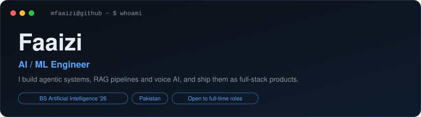</a>

<a href="https://github.com/mfaaizi/mfaaizi">
  <picture>
    <source media="(prefers-color-scheme: dark)" srcset="https://raw.githubusercontent.com/mfaaizi/mfaaizi/main/dark_mode.svg">
    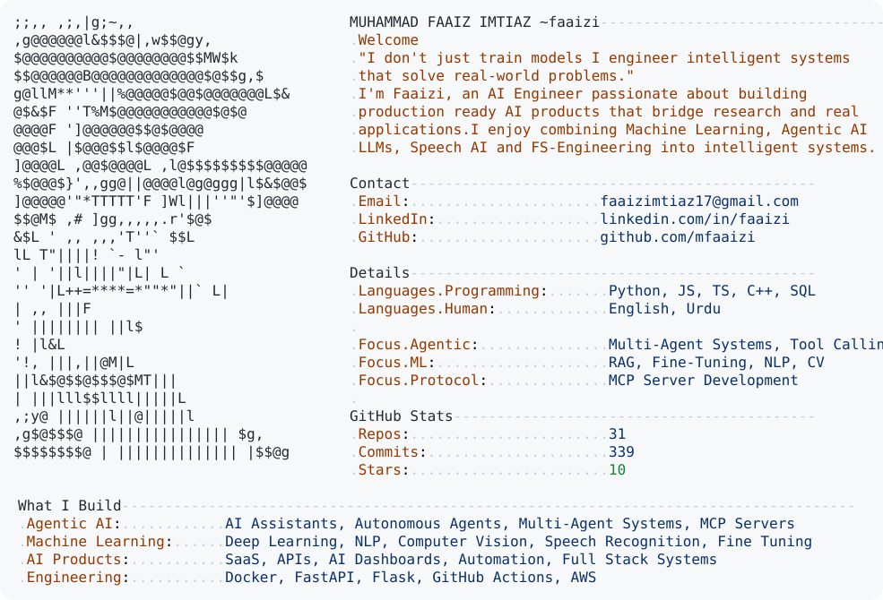
  </picture>
</a>

  
  
  

 

<picture>
  <source media="(prefers-color-scheme: dark)" srcset="https://raw.githubusercontent.com/mfaaizi/mfaaizi/output/github-contribution-grid-snake-dark.svg">
  <source media="(prefers-color-scheme: light)" srcset="https://raw.githubusercontent.com/mfaaizi/mfaaizi/output/github-contribution-grid-snake.svg">
  
</picture>

 

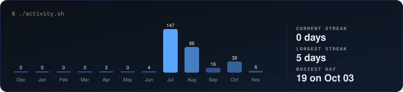

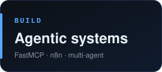
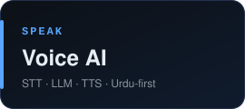
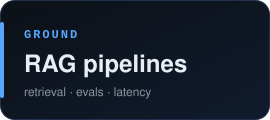

<!-- PROJECTS:START -->

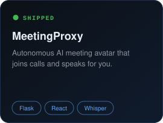
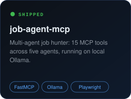
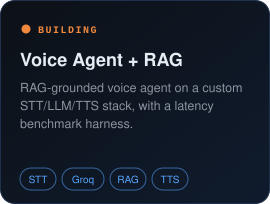

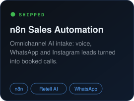

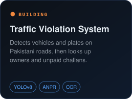

<!-- PROJECTS:END -->

